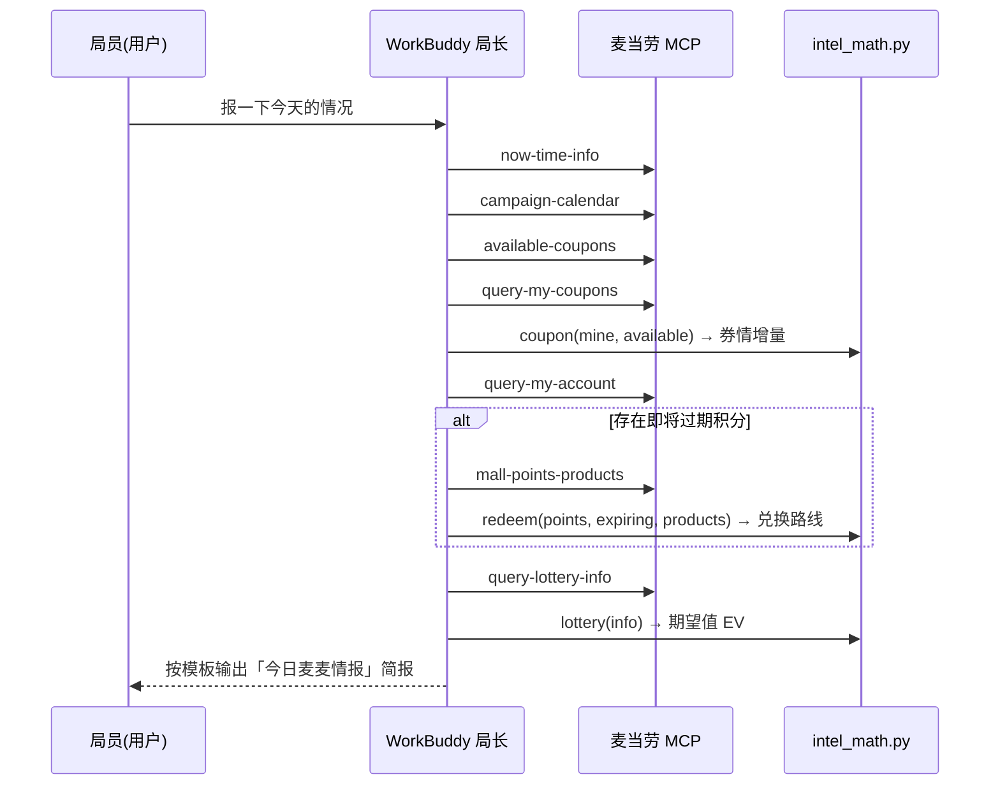
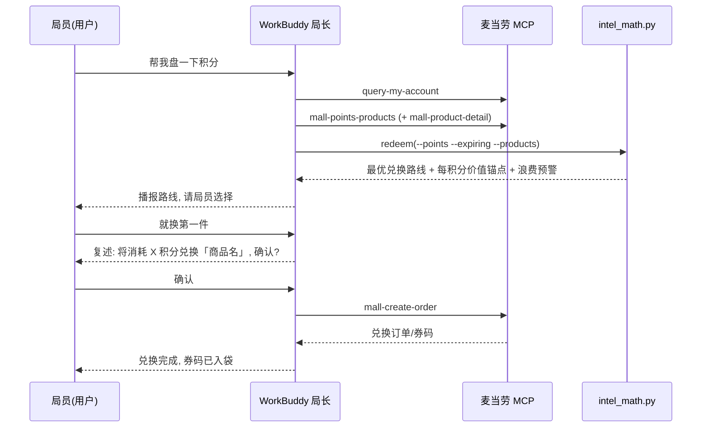

# MCP 集成说明 · MCP_INTEGRATION

本文档说明「麦麦情报局」**实际使用**的麦当劳 MCP 能力、调用流程与业务价值。

## 一、使用的 MCP Server

| 项目 | 值 |
|---|---|
| Server 名称 | `mcd-mcp` |
| 接入地址 | `https://mcd.mcd.cn` |
| 传输协议 | Streamable HTTP |
| 鉴权方式 | 请求头 `Authorization: Bearer <MCD_MCP_TOKEN>` |
| 限流 | 每 Token 600 次/分钟，超限返回 429 |
| 配置示例 | [`mcp-config.example.json`](mcp-config.example.json)（仅含环境变量占位符，无真实凭证） |

## 二、使用的 Tool 清单

本项目实际调用以下 14 个麦当劳 MCP Tool，覆盖「读情报 → 算结论 → 确认后兑现」三段式链路：

| # | Tool | 用途 | 板块 |
|---|---|---|---|
| 1 | `now-time-info` | 获取当前时间，判断早餐/限定时段 | 通用校准 |
| 2 | `campaign-calendar` | **当月营销活动日历**（情报头条） | 📅 活动日历 |
| 3 | `available-coupons` | 麦麦省当前可领券列表 | 🎫 券情速递 |
| 4 | `query-my-coupons` | 我的券库存（增量对比） | 🎫 券情速递 |
| 5 | `auto-bind-coupons` | 一键领取全部可领券（**写操作·需确认**） | 🎫 券情速递 |
| 6 | `query-my-account` | **积分账户**（可用/累计/冻结/**即将过期**） | 🏆 积分体检 |
| 7 | `mall-points-products` | 麦麦商城积分商品列表 | 🏆 积分体检 |
| 8 | `mall-product-detail` | 商品详情（核算积分性价比） | 🏆 积分体检 |
| 9 | `mall-create-order` | 积分兑换下单（**写操作·需确认**） | 🏆 积分体检 |
| 10 | `query-lottery-info` | 抽奖活动信息（奖池/概率/消耗） | 🎰 抽奖实验室 |
| 11 | `query-my-prizes` | 我的中奖记录 | 🎰 抽奖实验室 |
| 12 | `query-party-city` | 主题活动开放城市 | 🎉 主题雷达 |
| 13 | `query-party-store` / `query-partystore-date` / `query-partystore-session` | 门店/日期/场次三级下钻 | 🎉 主题雷达 |
| 14 | `party-order-create` | 主题活动预约下单（**写操作·需确认**） | 🎉 主题雷达 |

> 核心价值工具：`query-my-account`（过期积分预警）、`campaign-calendar`（活动情报）、
> `query-lottery-info`（EV 计算原料）、`mall-points-products`（兑换路线原料）。

## 三、调用流程

### 流程 A · 今日简报（主流程）



### 流程 B · 积分专项体检（含兑现）



## 四、数据流：从 MCP 返回到播报结论

MCP 返回的是业务原始结构，由 `intel_math.py` 归一化后做确定性精算：

```
MCP 返回                                intel_math.py            播报
──────────────────────                  ─────────────────       ──────────
query-my-account.expiringPoints  ──┐
mall-points-products.items[]     ──┼──►  plan_redemption()  ──►  "1200 分 14 天后过期，
    .point / .price / .title     ──┘    贪心: 过期积分优先       先兑拿铁再兑早餐券"
                                        + 每积分价值锚点

query-lottery-info.prizes[]      ──┐
    .probability / .worth        ──┼──►  lottery_ev()       ──►  "消耗 500 分/次,
    .consumePoints               ──┘    EV = Σ概率×价值          期望回报 ¥3.2, 建议不抽"

query-my-coupons.coupons[]       ──┐
available-coupons.list[]         ──┼──►  coupon_radar()     ──►  "本周新增 3 张券,
                                  ──┘    差集 = 新券增量           回复一键领券处理"
```

字段别名兼容（`point/points/needPoint`、`price/cash/worth`、`probability/rate` 等）
在模块内统一归一化，Agent 只需原样传递 MCP 业务数组，降低prompt 长度与幻觉面。

## 五、安全与节流设计

1. **写操作确认门控**：领券、兑换、抽奖、预约四类写操作一律「复述动作 + 消耗 → 局员确认 → 执行」，杜绝误下单。
2. **限流预算**：单次简报的 MCP 查询控制在 10 次以内，远低于 600 次/分钟限制；连续追问场景由 Agent 侧做调用间隔。
3. **凭证零落盘**：Token 仅存在于用户本地环境变量，仓库内只有 `${MCD_MCP_TOKEN}` 占位符（见 `.env.example` 与 `mcp-config.example.json`）。
