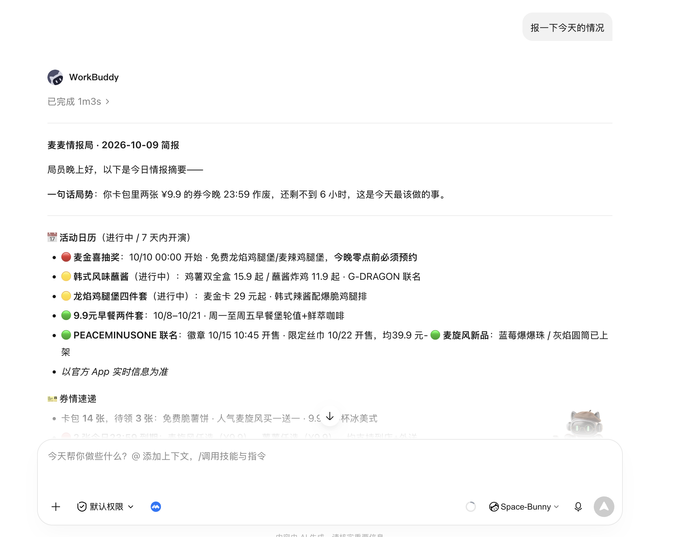
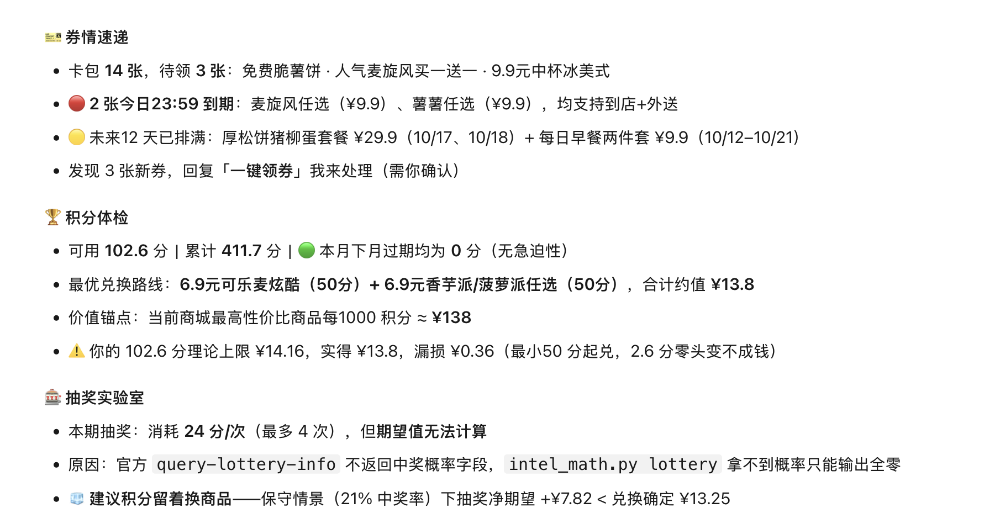
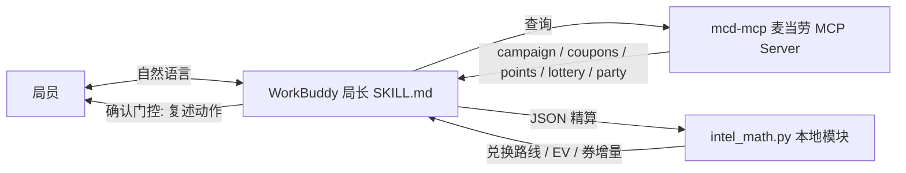

# 🕵️ 麦麦情报局 · McIntel Bureau

> **每天一句话，麦麦世界的情报全知道。**
> 基于**麦当劳 MCP** 打造的 WorkBuddy 情报 Skill：活动日历、券情速递、积分体检、抽奖期望值、主题活动雷达——五局合一，只报你该知道的。

**🍔 2026 麦当劳程序员节创意开发大赛参赛作品**

---

## 为什么需要情报局？

麦门信徒的日常痛点：

- 😮‍💨 积分悄悄过期，想起来时已经清零
- 😮‍💨 券包里躺着 8 张券，永远记不住哪张快到期
- 😮‍💨 抽奖活动眼花缭乱，不知道概率值不值
- 😮‍💨 限定活动总在结束后才刷到

**交易工具帮你省钱，情报工具帮你「不漏」。** 麦麦情报局不替你下单，它每天把麦麦世界扫一遍，告诉你：*什么在发生、什么快过期、什么值得动*。

## 五大情报板块

| 板块 | 干什么 | 底层 MCP Tool |
|---|---|---|
| 📅 **活动日历** | 当月活动解读，只挑「进行中 + 7 天内开演」 | `campaign-calendar` |
| 🎫 **券情速递** | 我的券 × 可领券差集，新券播报 + 到期预警 | `available-coupons` `query-my-coupons` `auto-bind-coupons` |
| 🏆 **积分体检** | **即将过期预警** + 最优兑换路线 + 每积分价值锚点 | `query-my-account` `mall-points-products` `mall-create-order` |
| 🎰 **抽奖实验室** | 奖池结构 → 盈亏平衡分析（官方未公开概率，**拒绝输出伪 EV**） | `query-lottery-info` `query-my-prizes` |
| 🎉 **主题雷达** | 城市活动 × 门店 × 场次三级下钻 | `query-party-city/store/date/session` `party-order-create` |

情报分级：🔴 紧急（快过期/快结束）· 🟡 关注 · 🟢 日常。先结论，后细节，数字说话。

## 60 秒上手

**前置**：一个麦当劳 MCP Token（[open.mcd.cn/mcp](https://open.mcd.cn/mcp) 手机号登录 → 控制台 → 激活，免费）+ [WorkBuddy](https://www.workbuddy.cn/)。

```text
① WorkBuddy → 专家·技能·连接器 → 连接器 → 自定义连接器 → 配置 MCP
   粘贴 mcp-config.example.json 内容，把 ${MCD_MCP_TOKEN} 换成你的 Token → 保存并启用

② 把本仓库 skills/mcd-intel-bureau/ 目录导入 WorkBuddy 技能
   （SKILL.md 为技能定义，intel_math.py 为本地精算模块）

③ 对它说：
```

> **「报一下今天的情况」**

局长立刻出勤：时间校准 → 拉日历 → 盘券 → 体检积分 → 算抽奖 EV → 按模板播报简报。

更多问法见 [docs/usage-examples.md](docs/usage-examples.md)。

## 情报样张（真实会话 · 已脱敏）




````text
麦麦情报局 · 2026-10-09 简报

一句话局势：卡包里 2 张 ¥9.9 券今晚 23:59 到期，先花掉再考虑别的。

📅 活动日历
  🟢 麦麦积分抽奖：进行中 · 长期活动 · 单抽 24 积分
🎫 券情速递
  库存 14 张
  🔴 麦旋风任选 ¥9.9、薯薯任选 ¥9.9 —— 今日 23:59 到期
🏆 积分体检
  可用 102.6 分｜累计 411.7 分｜本月/下月无过期
  最优兑换路线：6.9元可乐麦炫酷(50分) + 6.9元香芋派任选(50分) = 100 分换 13.8 元
  价值锚点：全商城最高性价比 0.138 元/分（每千分 ≈ ¥138）
  ⚠️ 已有 309.1 分过期（历史），本月起情报局帮你盯住
🎰 抽奖实验室
  单抽 24 分 ≈ ¥3.31（按兑换锚点折算）；奖池 10 档均为券/积分
  盈亏平衡：中奖率需 ≥ ~35% 才回本（官方未公开概率，仅供参考）
🎉 主题雷达
  本周雷达无信号，下周再扫

局长贴士：100 积分今天就能换成两件小食，比抽奖期望划算得多。
````

> 以上来自 2026-10-09 WorkBuddy 真机会话（账户号已脱敏），完整对话见 [workbuddy.md](workbuddy.md)。

## 架构



**三段式设计**：读情报（只读工具）→ `intel_math.py` 确定性精算（贪心兑换路线、概率期望值、券差集）→ 确认门控后兑现（领券/兑换/预约均需局员二次确认）。

精算模块零依赖（Python 3 标准库），独立可用。已按真机 MCP 返回字段适配（`spuName/spuId/point/downTime`、`drawPoint`，下架判定看 `downTime` 而非 `status`）：

```bash
python3 skills/mcd-intel-bureau/intel_math.py redeem \
  --points 3850 --expiring 1200 --deadline-days 14 --products products.json

# 抽奖：需传积分锚点（来自 redeem 的 value_per_point），无概率数据时输出盈亏平衡分析
python3 skills/mcd-intel-bureau/intel_math.py lottery --info lottery.json --point-value 0.138
```

## 目录结构

```text
mcd-intel-bureau/
├── README.md                        # 你正在看
├── CONTEST_DECLARATION.md           # 参赛声明（官方模板）
├── MCP_INTEGRATION.md               # MCP 集成：Tool 清单 / 调用流程 / 数据流
├── mcp-config.example.json          # MCP 配置示例（仅环境变量占位符）
├── workbuddy.md                     # WorkBuddy 开发对话上下文
├── skills/mcd-intel-bureau/
│   ├── SKILL.md                     # 技能定义：人设 / 工作流 / 硬规则
│   ├── briefing.md                  # 简报输出模板
│   └── intel_math.py                # 情报精算核心（零依赖）
└── docs/
    └── usage-examples.md            # 对话示例集
```

## 目标用户

- 🍟 **麦门信徒**：每周至少一顿麦麦，想知道「这周有什么活动」
- 💰 **羊毛学家**：券与积分是资产，资产需要管家
- 🧑‍💻 **AI Agent 玩家**：想看 MCP 落地「每日情报官」这一形态的参考实现

## 声明

- 本项目为 **麦当劳程序员节创意开发大赛** 参赛作品，由参赛者独立开发，**非麦当劳官方产品**。
- 餐品信息、价格、活动以麦当劳官方渠道实时信息为准；项目输出仅供参考，不构成任何专业建议。
- 配置文件仅使用环境变量占位符，不包含任何真实凭证（`CONTEST_DECLARATION.md`）。

## License

[MIT](LICENSE) © 2026 麦麦情报局开发者
